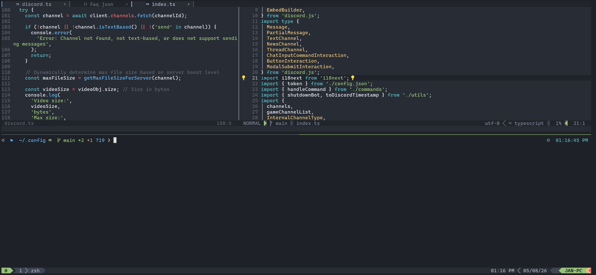

# dotfiles

<p>
  
  
  
  
  
  
</p>

> A batteries-included **Zsh + Tmux + Neovim** setup tuned for fast TypeScript / JavaScript work — that has traveled the world with me.



---

## Why this config?

- **Modern Neovim, hand-rolled** — `lazy.nvim` managing ~35 curated plugins (Telescope, Mason LSP, nvim-cmp, Lspsaga, Conform, Gitsigns, Oil, Barbar, Lualine, Onedark, Hop / Lightspeed, Persisted sessions, Yanky, render-markdown, tiny-inline-diagnostic, and more).
- **TypeScript / JavaScript first** — preconfigured LSPs (`typescript`, `eslint_d`, `prettierd`, `tailwindcss`, `cssls`, `json-lsp`), Jest runner, React-extract refactors.
- **AI-ready out of the box** — GitHub Copilot + CopilotChat wired into Neovim, plus an OpenCode config included.
- **Seamless tmux ↔ nvim navigation** — one set of keys to move between panes and splits, regardless of which side you're on.
- **Polished shell** — Powerlevel10k prompt with `zsh-autosuggestions`, `zsh-syntax-highlighting`, `zsh-history-substring-search`, and `zsh-z` for fast jumping.
- **One-command bootstrap** — `setup.sh` handles installs and symlinks; manual steps are documented for the rest.
- **Cross-platform** — works on macOS, Linux, and WSL2 (with caveats noted in Troubleshooting).
- **Portable** — everything lives in a single `~/.config` repo; clone it on a new machine and you're back in business.

---

## Tech stack

| Layer         | Tool                                  | Purpose                 |
| ------------- | ------------------------------------- | ----------------------- |
| Shell         | Zsh + Oh My Zsh + Powerlevel10k       | Prompt & UX             |
| Multiplexer   | Tmux + tpm                            | Sessions / panes        |
| Editor        | Neovim nightly (via [bob])            | Main editor             |
| Editor (Java) | IntelliJ IDEA + `.ideavimrc`          | JVM work                |
| Terminal      | iTerm2 (mac) / any modern terminal    | Host terminal           |
| Font          | Caskaydia Cove Nerd Font              | Glyph / icon support    |
| Theme         | One Dark                              | Terminal + Neovim       |
| Node mgr      | [fnm]                                 | Node version management |
| AI            | GitHub Copilot, CopilotChat, OpenCode | N/A                     |

[bob]: https://github.com/MordechaiHadad/bob
[fnm]: https://github.com/Schniz/fnm

---

## Quick start

```bash
# 1. Clone into ~/.config (back up first if it already has things you care about)
git clone https://github.com/jancodes/dotfiles.git ~/.config

# 2. Run the bootstrap script
chmod +x ~/.config/setup.sh
~/.config/setup.sh
```

The script automates the install/symlink steps and prints any remaining manual steps at the end.

> Note: these configs currently do **not** work with Warp.

---

## Manual setup

<details>
<summary>Click to expand the full step-by-step guide</summary>

_Last updated 04/28/2026_

1.  Install iTerm2
    > https://iterm2.com/downloads.html
2.  Clone this repo into `~/.config`. If your computer is not new, there might be a `.config` folder already — move anything important out of it or remove it before cloning.
    > `rm -rf ~/.config && git clone https://github.com/jancodes/dotfiles.git ~/.config`
3.  Install Homebrew
    > `/bin/bash -c "$(curl -fsSL https://raw.githubusercontent.com/Homebrew/install/HEAD/install.sh)"`
4.  Install Zsh (https://github.com/ohmyzsh/ohmyzsh/wiki/Installing-ZSH)
    > `brew install zsh`
5.  Install fnm (https://github.com/Schniz/fnm)
    > `brew install fnm`
6.  Install Node with fnm and use it

    > `fnm install --lts`

    > `fnm use lts/latest`

7.  Install Oh My Zsh
    > `sh -c "$(curl -fsSL https://raw.githubusercontent.com/ohmyzsh/ohmyzsh/master/tools/install.sh)"`
8.  Install Zsh plugins:

    > `git clone https://github.com/zsh-users/zsh-autosuggestions $ZSH_CUSTOM/plugins/zsh-autosuggestions`

    > `git clone https://github.com/zsh-users/zsh-history-substring-search ${ZSH_CUSTOM:-~/.oh-my-zsh/custom}/plugins/zsh-history-substring-search`

    > `git clone https://github.com/zsh-users/zsh-syntax-highlighting.git ${ZSH_CUSTOM:-~/.oh-my-zsh/custom}/plugins/zsh-syntax-highlighting`

    > `git clone https://github.com/agkozak/zsh-z ${ZSH_CUSTOM:-~/.oh-my-zsh/custom}/plugins/zsh-z`

9.  Install Powerlevel10k theme
    > `git clone --depth=1 https://github.com/romkatv/powerlevel10k.git ${ZSH_CUSTOM:-$HOME/.oh-my-zsh/custom}/themes/powerlevel10k`
10. Symlink `.zshrc` and `.gitconfig`

    `rm -rf ~/.zshrc && ln -s ~/.config/.zshrc ~/.zshrc`

    `rm -rf ~/.gitconfig && ln -s ~/.config/.gitconfig ~/.gitconfig`

11. Set theme and fonts in your terminal of choice

    > https://www.nerdfonts.com/font-downloads (using **Caskaydia Cove Nerd Font Complete Mono Regular**)

    > https://github.com/one-dark/iterm-one-dark-theme/blob/main/One%20Dark.itermcolors (One Dark for iTerm2)

    > For WSL2 font issues, restart Windows Explorer.

12. Install Tmux
    > `brew install tmux`
13. Install tpm
    > `git clone https://github.com/tmux-plugins/tpm ~/.tmux/plugins/tpm`
14. Symlink `.tmux.conf`
    > `ln -s ~/.config/.tmux.conf ~/.tmux.conf`
15. Install tmux plugins via `prefix + I` (Mac uses `Ctrl`, Windows/WSL uses `Alt` — e.g. `Ctrl-A` is the prefix on Mac)

    If you see extra keys being typed while in tmux on Mac, follow this guide to install the missing terminfo entries:

    > https://gist.github.com/bbqtd/a4ac060d6f6b9ea6fe3aabe735aa9d95#the-right-way

16. Install Neovim nightly with [bob]

    > `bob use nightly`

17. Install Neovim plugin dependencies
    > `brew install gcc make gnu-sed ripgrep fd fzf`
18. Install LSPs via Mason

    > Run `:Mason` inside Neovim and pick the LSPs you want.

    LSPs used: `lua, prettierd, json-lsp, typescript, tailwindcss, eslint_d, cssls`

    `lua`, `json`, `typescript`, `tailwindcss`, and `cssls` are installed by default through Mason lspconfig. `eslint_d` and `prettierd` need to be installed manually with `:Mason`.

19. Optional extras

    > https://github.com/commitizen/cz-cli — beautiful commit messages

    > https://github.com/yosukes-dev/one-dark-windows-terminal (WSL only)

    > https://command-not-found.com/xdg-open (WSL only)

    > https://github.com/cpbotha/xdg-open-wsl — `xdg-open` replacement for WSL

20. Optional: Install VcXsrv and xclip (WSL only) — https://sourceforge.net/projects/vcxsrv/

    Follow Step 2; this config already has Step 3 set up.

    > https://gist.github.com/necojackarc/02c3c81e1525bb5dc3561f378e921541#2-set-up-vcxsrv-windows-x-server

    > https://installati.one/ubuntu/20.04/xclip/

    > If clipboard still doesn't work, check whether your firewall is blocking VcXsrv.

</details>

---

## Cheatsheet

### Tmux

| Keys         | Action               |
| ------------ | -------------------- |
| `prefix + [` | Enter Vim copy mode  |
| `prefix + I` | Install tmux plugins |

### Neovim — Telescope live-grep args

> Source: https://github.com/nvim-telescope/telescope-live-grep-args.nvim

- `"foo" --iglob` — search for `foo` ignoring ignore-files
- `"foo" --tts` — search for `foo` only in TypeScript files
- `rg --type-list` — list all available types (pipe to `rg "filter"` to narrow down)

| Mapping | Action                              |
| ------- | ----------------------------------- |
| `<C-k>` | Quote prompt, e.g. `foo` → `"foo" ` |

#### Grep argument examples

| Prompt                   | Args                      | Description                            |
| ------------------------ | ------------------------- | -------------------------------------- |
| `foo bar`                | `foo bar`                 | search for „foo bar"                   |
| `"foo bar" baz`          | `foo bar`, `baz`          | search for „foo bar" in dir „baz"      |
| `--no-ignore "foo bar"`  | `--no-ignore`, `foo bar`  | search for „foo bar" ignoring ignores  |
| `"foo" ../other-project` | `foo`, `../other-project` | search for „foo" in `../other-project` |

---

## Troubleshooting

### WSL

- WSL optimization guide: https://jade.fyi/blog/development-in-wsl/
- For MarkdownPreview, use `wsl-open`.
- If `gcc` postinstall fails, make sure `build-essential` is installed.

### macOS

- Faster `hjkl` repeat in Vim:
  ```bash
  defaults write -g ApplePressAndHoldEnabled -bool false
  ```
- Extra keys appearing in tmux? Install the proper terminfo: https://gist.github.com/bbqtd/a4ac060d6f6b9ea6fe3aabe735aa9d95#the-right-way

### Fonts

- WSL2 font issues: restart Windows Explorer after installing the Nerd Font.

---

## License

[MIT](LICENSE) — free to use, modify, distribute, and sell. Just keep the copyright notice.

---

Made by [@jancodes](https://github.com/jancodes) · MIT Licensed
